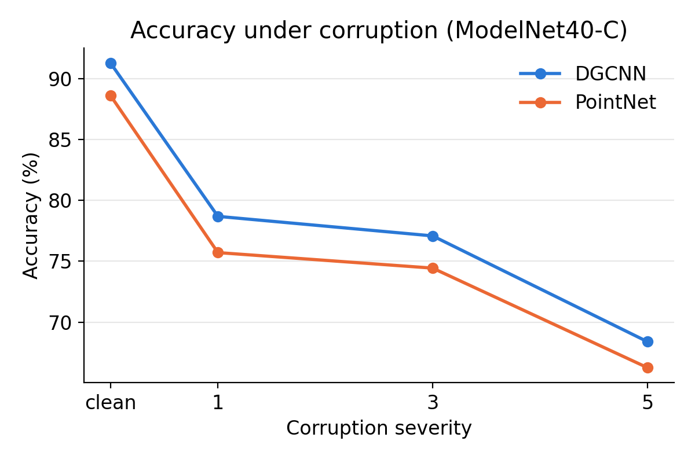
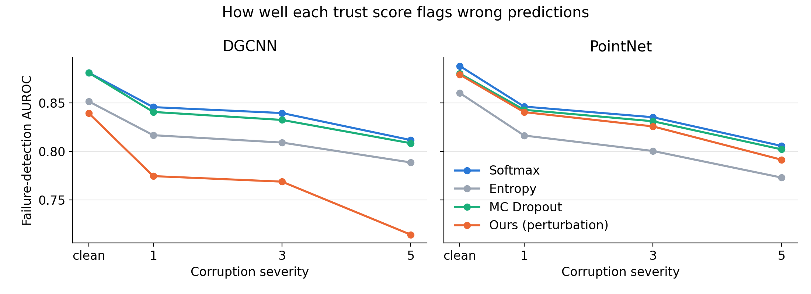
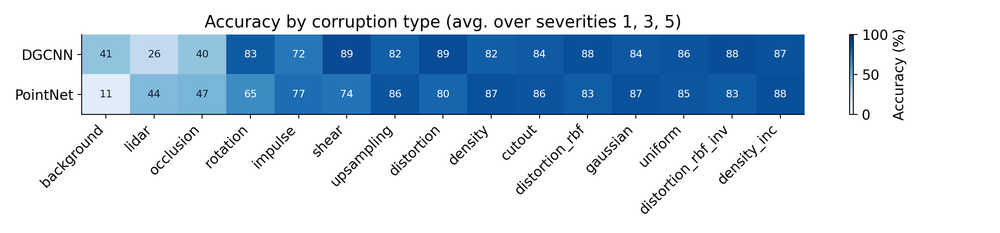
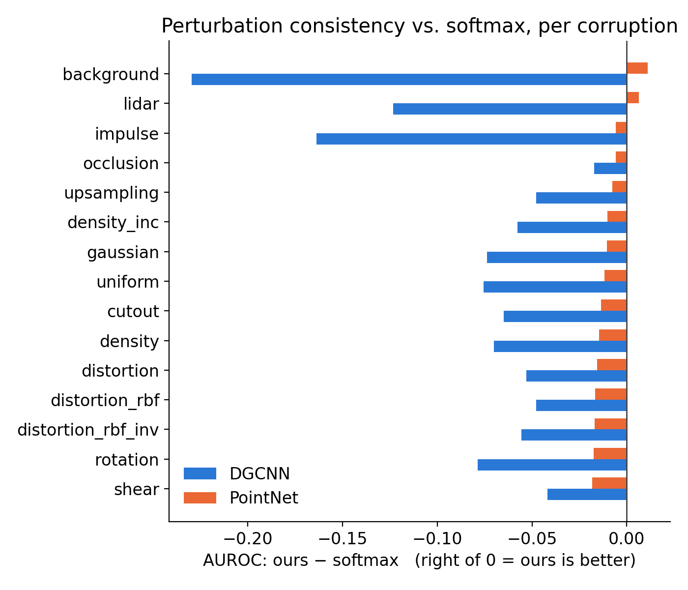

# Failure Detection in 3D Point Cloud Classifiers under Real-World Corruption

**Can a point cloud classifier tell when it is wrong?** This project benchmarks how well different *trust scores* flag incorrect predictions made by PointNet and DGCNN on corrupted 3D data, and tests a perturbation-consistency score as a cheap alternative to standard uncertainty methods.

*Course research project, 3D Computer Vision, Wayne State University (Fall 2026). Author: Sanika Annadate.*

---

## Motivation

Real 3D sensors (LiDAR, depth cameras) produce noisy, incomplete point clouds: occlusion, missing chunks, stray background points, sensor noise. Classifiers trained on clean data degrade on such inputs, and often **fail silently**. In safety-critical settings such as self-driving cars and robotics, a model that can say *"I'm not sure"* is far safer than one that is confidently wrong.

This project asks: **given a corrupted input, which trust score best separates correct predictions from wrong ones?**

## Method

<p align="center"><b>Corrupted input → classifier → prediction → trust score → trust it, or flag it</b></p>

1. **Train** PointNet and DGCNN on clean ModelNet40 (1,024 points per object).
2. **Test** on ModelNet40-C: 15 realistic corruption types at severities 1, 3, and 5, plus the clean test set.
3. **Score every prediction** with four trust scores:

| Trust score | Idea | Cost |
|---|---|---|
| **Max softmax probability** | Confidence of the top class | 1 forward pass |
| **Entropy** | How spread out the class probabilities are | 1 forward pass |
| **MC Dropout** | Average probability of the predicted class over K passes with dropout on | K passes |
| **Perturbation consistency (proposed)** | Average probability of the original predicted class over K slightly perturbed copies of the input | K passes |

For perturbation consistency, each copy gets small random jitter (σ = 0.01, clipped at 0.02) and ~10% of its points dropped (replaced with a duplicate point so the size stays at 1,024). The intuition: if tiny changes to the input flip the model's answer, the answer probably shouldn't be trusted. K = 8 for both K-pass methods.

4. **Grade each trust score** against the true labels:
   - **AUROC**: does the score rank correct predictions above wrong ones? (0.5 = random, 1.0 = perfect)
   - **AURC**: error rate on what's left if the model abstains on its least-trusted predictions (lower = better)
   - **ECE**: calibration error of the softmax confidence

## Results

### Clean and corrupted accuracy

| Model | Clean | Severity 1 | Severity 3 | Severity 5 |
|---|---|---|---|---|
| DGCNN | 91.3% | 78.7% | 77.1% | 68.4% |
| PointNet | 88.6% | 75.7% | 74.4% | 66.3% |

<p align="center"></p>

### Main result: failure-detection AUROC (average over all corruptions and severities)

| Model | Softmax | Entropy | MC Dropout | **Perturbation (ours)** |
|---|---|---|---|---|
| DGCNN | **0.832** | 0.805 | 0.827 | 0.752 |
| PointNet | **0.829** | 0.797 | 0.825 | 0.819 |

<p align="center"></p>

### Which corruptions hurt most

<p align="center"></p>

### Where perturbation consistency beats softmax

<p align="center"></p>

## Key findings

1. **Softmax confidence is a strong, free baseline.** It was the best failure detector on average for both models, and MC Dropout matched it closely at 8× the cost. This echoes findings in image classification that simple confidence is hard to beat for misclassification detection.
2. **Perturbation consistency is competitive on PointNet but not on DGCNN.** On PointNet it nearly matched softmax (0.819 vs. 0.829) and slightly outperformed it on the two hardest corruptions, background noise (0.596 vs. 0.585) and LiDAR (0.763 vs. 0.756). On DGCNN it trailed on every corruption. A plausible (not yet tested) explanation: duplicating points disrupts DGCNN's k-nearest-neighbor graphs, while PointNet's max pooling is largely unaffected by duplicates.
3. **Averaging probabilities beats counting votes.** Using the average probability across K copies, instead of the fraction of copies that agree, raised AUROC substantially (PointNet: 0.819 vs. 0.583; DGCNN: 0.752 vs. 0.685), because vote counts produce many ties.
4. **Detection gets harder as corruption gets worse**, for every method (e.g., DGCNN softmax AUROC 0.846 → 0.812 from severity 1 to 5).
5. **The models are underconfident, not overconfident.** DGCNN is 91% accurate on clean data but only 69% confident on average, likely due to label smoothing in the training recipe.
6. **Architectures fail differently.** PointNet collapses under background noise (11% accuracy); DGCNN is more accurate overall but worse than PointNet on LiDAR (26% vs. 44%) and occlusion (40% vs. 47%).
7. **Test-time averaging over perturbed copies does not fix errors.** It lowered accuracy, especially for DGCNN (severity 1: 78.7% → 74.6%), so detection, not correction, is the useful role of the perturbation signal here.

## Limitations and future work

- Corrupted data evaluated at severities 1, 3, and 5 only (compute limits); single random seed.
- DGCNN trained for 50 epochs (PointNet for 100); the PointNet implementation is the simplified version from the DGCNN repository (no T-Net).
- Only one perturbation recipe was tested. Next steps: a jitter-only ablation to test the DGCNN neighbor-graph explanation, varying K (4/8/16), and point-subsampling instead of duplication.
- Real-scan evaluation (e.g., ScanObjectNN) to check that findings transfer beyond synthetic corruptions.

## Repository structure

```
├── README.md
├── notebooks/
│   ├── colab_pipeline.ipynb     # setup, training, DGCNN evaluation, analysis, figures
│   └── kaggle_pointnet.ipynb    # PointNet evaluation
├── results/
│   └── all_results.csv          # every metric, per model × corruption × severity
└── figures/                     # plots used above
```

## How to run

1. Open `notebooks/colab_pipeline.ipynb` in Google Colab with a **T4 GPU** runtime.
2. Run the setup cells: they mount Google Drive, clone the [DGCNN repository](https://github.com/WangYueFt/dgcnn), and download ModelNet40 (HDF5, 2,048-point version) and [ModelNet40-C](https://zenodo.org/records/6017834).
3. Train both models (~45 min PointNet, ~2 h DGCNN on a T4).
4. Run the evaluation loop (results are saved per file, so it can resume after a disconnect), then the analysis and figure cells.
5. `notebooks/kaggle_pointnet.ipynb` runs the same evaluation for PointNet on Kaggle; it expects the trained checkpoints as a Kaggle dataset input.

**Requirements:** Python 3, PyTorch, NumPy, h5py, scikit-learn, pandas, matplotlib.

## Acknowledgments and references

- Model code: [WangYueFt/dgcnn](https://github.com/WangYueFt/dgcnn) (PyTorch implementations of PointNet and DGCNN).
- Data: ModelNet40 (Wu et al., 2015); ModelNet40-C (Sun et al., 2022).

References:
- Qi, C. R., Su, H., Mo, K., & Guibas, L. J. (2017). PointNet: Deep learning on point sets for 3D classification and segmentation. *CVPR*.
- Wang, Y., Sun, Y., Liu, Z., Sarma, S. E., Bronstein, M. M., & Solomon, J. M. (2019). Dynamic graph CNN for learning on point clouds. *ACM Transactions on Graphics, 38*(5).
- Wu, Z., Song, S., Khosla, A., Yu, F., Zhang, L., Tang, X., & Xiao, J. (2015). 3D ShapeNets: A deep representation for volumetric shapes. *CVPR*.
- Sun, J., Zhang, Q., Kailkhura, B., Yu, Z., Xiao, C., & Mao, Z. M. (2022). Benchmarking robustness of 3D point cloud recognition against common corruptions. *arXiv:2201.12296*.
- Hendrycks, D., & Gimpel, K. (2017). A baseline for detecting misclassified and out-of-distribution examples in neural networks. *ICLR*.
- Gal, Y., & Ghahramani, Z. (2016). Dropout as a Bayesian approximation: Representing model uncertainty in deep learning. *ICML*.
- Ayhan, M. S., & Berens, P. (2018). Test-time data augmentation for estimation of heteroscedastic aleatoric uncertainty in deep neural networks. *MIDL*.
- Guo, C., Pleiss, G., Sun, Y., & Weinberger, K. Q. (2017). On calibration of modern neural networks. *ICML*.
